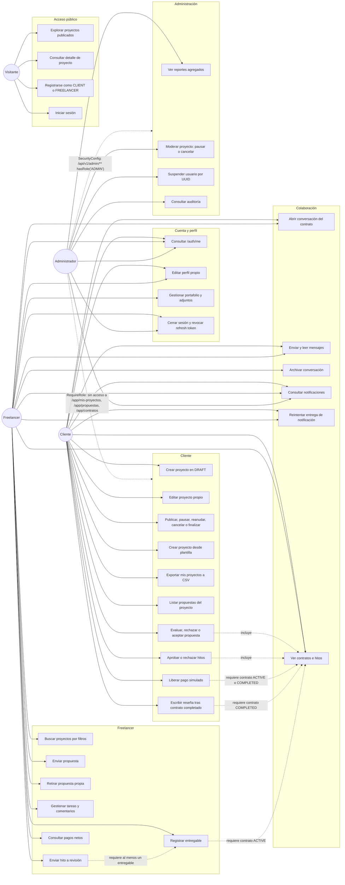

# Casos de uso

Actores y funcionalidades expuestas por la API `v1`. La autorización real vive en
el backend (`SecurityConfig` + `@PreAuthorize`); el frontend replica la restricción
con `RequireAuth` y `RequireRole` para no mostrar acciones que el servidor rechazaría.

## Restricciones de acceso

| Ámbito | Regla de backend | Regla de frontend |
|--------|------------------|-------------------|
| `/api/v1/admin/**` | `hasRole('ADMIN')` en `SecurityConfig` y `@PreAuthorize` a nivel de clase (`AdminController`, `AuditController`). | Rutas bajo `RequireRole roles={["ADMIN"]}`. |
| Crear/editar/publicar proyectos | Propiedad del proyecto (`clientId`) validada en los casos de uso. | `RequireRole roles={["CLIENT"]}`. |
| Propuestas | Solo `FREELANCER` con perfil profesional; retiro solo del autor. | El formulario solo se muestra al freelancer. |
| Contratos, pagos y reseñas | Solo las dos partes del contrato; el pago solo lo libera el cliente dueño. | `RequireRole roles={["CLIENT","FREELANCER"]}` y comprobación de participación. |
| Administración | El admin **no** es parte de contratos ni tiene perfil público. | La navegación admin se limita a reportes, moderación, usuarios y auditoría. |

> El catálogo público (`GET /projects`) no requiere autenticación. La UI consulta
> por defecto `status=PUBLISHED` para no exponer borradores.

## Referencias

- Contratos de endpoints: [`docs/uml/README.md`](./README.md) y `frontend/schema/openapi.json`.
- Reglas de negocio y limitaciones: [`frontend/README.md`](../../frontend/README.md).
- Seguridad: `src/main/java/com/freeconnect/identity/infrastructure/security/SecurityConfig.java`.
