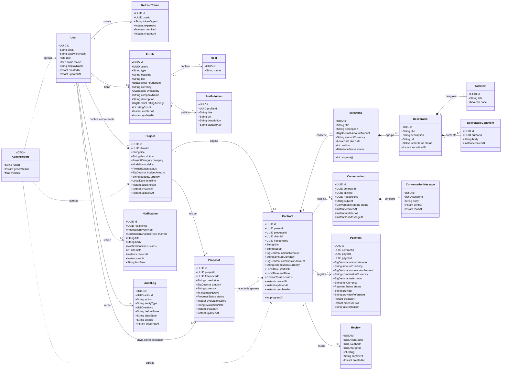

# Clases de dominio

Modelo inferido de las entidades JPA y de los agregados de dominio. Los importes se
representan con el value object `Money` (`amount` + `currency`), aunque en la
persistencia se aplanan en columnas `*_amount` / `*_currency`.

## Enumeraciones relevantes

| Enum | Valores |
|------|---------|
| `Role` | `FREELANCER`, `CLIENT`, `ADMIN` |
| `UserStatus` | `ACTIVE`, `SUSPENDED` |
| `ProjectStatus` | `DRAFT`, `PUBLISHED`, `PAUSED`, `IN_PROGRESS`, `FINISHED`, `CANCELLED` |
| `ProposalStatus` | `SUBMITTED`, `WITHDRAWN`, `ACCEPTED`, `REJECTED` |
| `ContractStatus` | `DRAFT`, `ACTIVE`, `COMPLETED`, `CANCELLED` |
| `MilestoneStatus` | `PENDING`, `IN_PROGRESS`, `SUBMITTED`, `APPROVED`, `REJECTED` |
| `DeliverableStatus` | `DRAFT`, `SUBMITTED`, `APPROVED`, `REJECTED` |
| `PaymentStatus` | `PENDING`, `RELEASED`, `FAILED`, `REFUNDED` |
| `ConversationStatus` | `ACTIVE`, `ARCHIVED` |
| `NotificationStatus` | `PENDING`, `SENT`, `FAILED` |
| `Modality` | `REMOTE`, `ONSITE`, `HYBRID` |
| `Availability` | `AVAILABLE`, `PART_TIME`, `UNAVAILABLE` |

## Invariantes que el diagrama no muestra

- Un `Contract` necesita al menos un `Milestone` y la suma de hitos no puede superar el monto del contrato.
- Un `Milestone` no se aprueba sin entregables y solo pasa a `APPROVED`/`REJECTED` desde `SUBMITTED`.
- El contrato se completa automáticamente cuando todos sus hitos están aprobados.
- Un `Review` solo se crea sobre un contrato `COMPLETED` y por una de sus partes.
- `AdminReport` no es una tabla: es un DTO calculado con el patrón Visitor sobre proyectos, contratos y usuarios.

> `%% TODO: confirmar` si en el futuro se añaden agregados como `Dispute` o `Invoice`; hoy no existen en el código.
