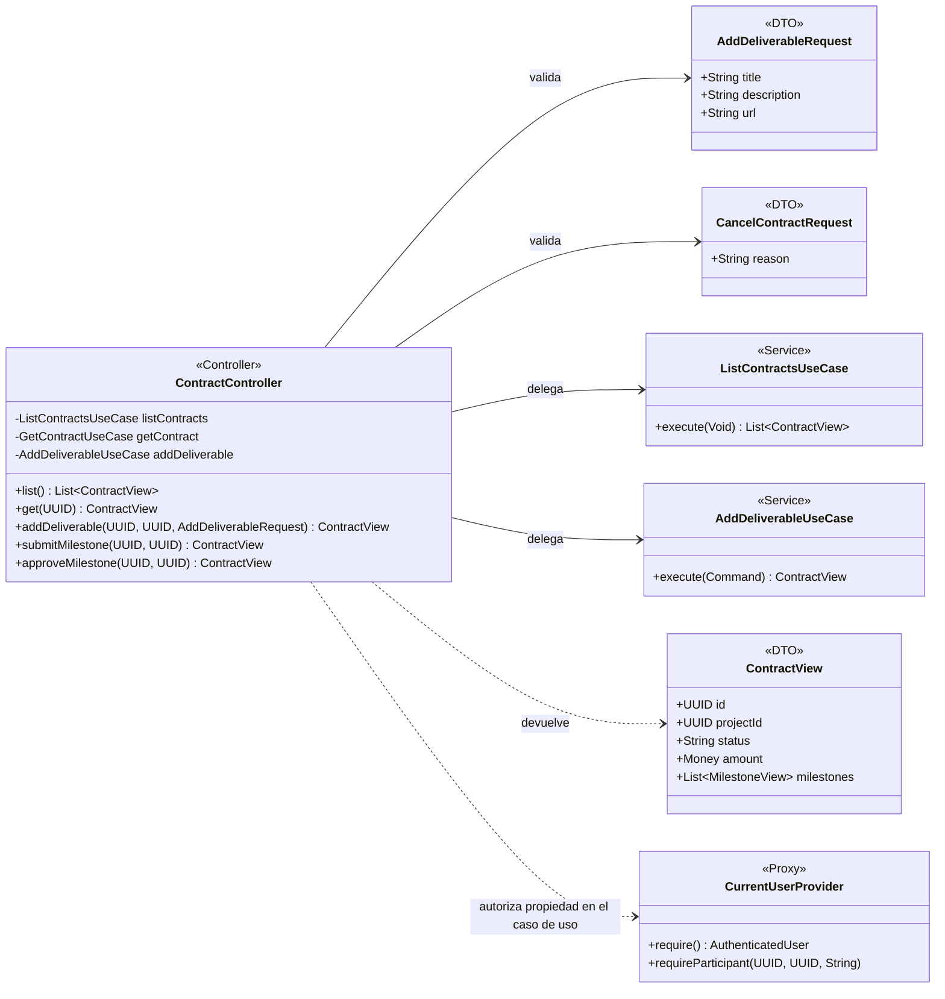
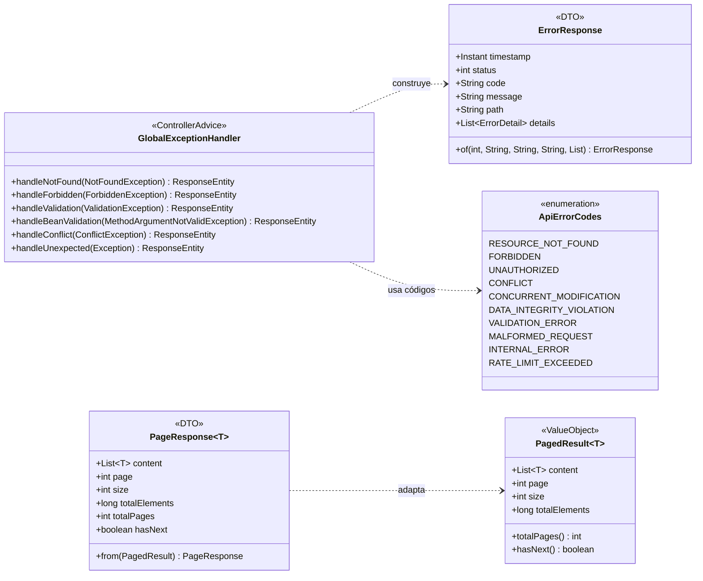

# Backend · API REST

| Campo | Valor |
|-------|-------|
| **Módulo** | Capa HTTP: controladores, DTO de entrada/salida y manejo uniforme de errores |
| **Código fuente** | `src/main/java/com/freeconnect/*/api/`, `src/main/java/com/freeconnect/shared/api/` |
| **Propósito** | Traducir HTTP ↔ comandos de caso de uso, validar la entrada, aplicar autorización por rol y devolver un contrato JSON estable bajo `/api/v1`. |

## 1. Estructura de un controlador y sus DTO

> El controlador **no** conoce repositorios ni entidades JPA. Sólo recibe DTO,
> construye un `Command`/`Query` y delega. La verificación de propiedad ocurre en
> el caso de uso mediante `CurrentUserProvider` (ver [`backend-seguridad.md`](./backend-seguridad.md)).

## 2. Mapa de endpoints

Todos los endpoints cuelgan de `/api/v1`.

| Método | Ruta | Controlador | Rol / regla | Respuesta |
|--------|------|-------------|-------------|-----------|
| POST | `/auth/register` | `identity/api/AuthController.java:59` | Público | `201` + `AuthResponse` |
| POST | `/auth/login` | `AuthController.java:70` | Público | `AuthResponse` |
| POST | `/auth/refresh` | `AuthController.java:76` | Público (refresh token) | `AuthResponse` |
| POST | `/auth/logout` | `AuthController.java:82` | Autenticado | `204` |
| GET | `/auth/me` | `AuthController.java:89` | Autenticado | `UserView` |
| GET | `/projects` | `projects/api/ProjectController.java:79` | Público | `PageResponse<ProjectView>` |
| GET | `/projects/{id}` | `ProjectController.java:102` | Público | `ProjectView` |
| POST | `/projects` | `ProjectController.java:108` | `CLIENT` | `201` + `ProjectView` |
| PUT | `/projects/{id}` | `ProjectController.java:118` | `CLIENT` | `ProjectView` |
| PATCH | `/projects/{id}/status` | `ProjectController.java:127` | `CLIENT` | `ProjectView` |
| GET | `/projects/templates` | `ProjectController.java:135` | Público | `List<ProjectTemplateView>` |
| POST | `/projects/from-template/{templateId}` | `ProjectController.java:141` | `CLIENT` | `201` + `ProjectView` |
| GET | `/projects/mine/export` | `ProjectController.java:149` | `CLIENT` | `text/csv` |
| GET | `/projects/{projectId}/proposals` | `proposals/api/ProposalController.java:70` | Autenticado | `List<ProposalView>` |
| POST | `/projects/{projectId}/proposals` | `ProposalController.java:60` | `FREELANCER` | `201` + `ProposalView` |
| DELETE | `/proposals/{id}` | `ProposalController.java:77` | `FREELANCER` | `ProposalView` |
| POST | `/proposals/{id}/evaluate` | `ProposalController.java:84` | `CLIENT` | `ProposalView` |
| POST | `/proposals/{id}/reject` | `ProposalController.java:92` | `CLIENT` | `ProposalView` |
| POST | `/proposals/{id}/accept` | `ProposalController.java:99` | `CLIENT` | `ContractView` |
| GET | `/contracts` | `contracts/api/ContractController.java:74` | Autenticado | `List<ContractView>` |
| GET | `/contracts/{id}` | `ContractController.java:81` | Autenticado | `ContractView` |
| POST | `/contracts/{id}/milestones/{milestoneId}/deliverables` | `ContractController.java:88` | `FREELANCER` | `ContractView` |
| POST | `/contracts/{id}/milestones/{milestoneId}/submit` | `ContractController.java:97` | `FREELANCER` | `ContractView` |
| POST | `/contracts/{id}/milestones/{milestoneId}/approve` | `ContractController.java:104` | `CLIENT` | `ContractView` |
| POST | `/contracts/{id}/milestones/{milestoneId}/reject` | `ContractController.java:111` | `CLIENT` | `ContractView` |
| POST | `/contracts/{id}/cancel` | `ContractController.java:120` | Autenticado (parte) | `ContractView` |
| POST | `/contracts/{id}/milestones/{milestoneId}/deliverables/{deliverableId}/tasks` | `ContractController.java:127` | `FREELANCER` | `ContractView` |
| PATCH | `/contracts/{id}/milestones/{milestoneId}/deliverables/{deliverableId}/tasks/{taskId}` | `ContractController.java:136` | `FREELANCER` | `ContractView` |
| POST | `/contracts/{id}/milestones/{milestoneId}/deliverables/{deliverableId}/comments` | `ContractController.java:146` | Autenticado (parte) | `ContractView` |
| POST | `/contracts/{contractId}/conversations` | `messaging/api/MessagingController.java:36` | Autenticado | `ConversationView` |
| GET | `/conversations` | `MessagingController.java:44` | Autenticado | `List<ConversationView>` |
| GET | `/conversations/{id}` | `MessagingController.java:51` | Autenticado | `ConversationView` |
| POST | `/conversations/{id}/messages` | `MessagingController.java:58` | Autenticado | `ConversationView` |
| POST | `/conversations/{id}/read` | `MessagingController.java:65` | Autenticado | `ConversationView` |
| POST | `/conversations/{id}/archive` | `MessagingController.java:72` | Autenticado | `ConversationView` |
| POST | `/contracts/{id}/payments` | `payments/api/PaymentController.java:36` | `CLIENT` | `201` + `PaymentView` |
| GET | `/contracts/{id}/payments` | `PaymentController.java:45` | Autenticado | `List<PaymentView>` |
| GET | `/payments` | `PaymentController.java:52` | Autenticado | `List<PaymentView>` |
| POST | `/contracts/{contractId}/reviews` | `reviews/api/ReviewController.java:37` | Autenticado (parte) | `201` + `ReviewView` |
| GET | `/contracts/{contractId}/reviews` | `ReviewController.java:46` | Autenticado | `List<ReviewView>` |
| GET | `/users/{userId}/reviews` | `ReviewController.java:53` | Autenticado | `List<ReviewView>` |
| GET | `/profiles/me` | `profiles/api/ProfileController.java:63` | Autenticado | `ProfileView` |
| PUT | `/profiles/me` | `ProfileController.java:69` | Autenticado | `ProfileView` |
| GET | `/profiles/{id}` | `ProfileController.java:77` | Autenticado | `ProfileView` |
| POST | `/profiles/me/portfolio` | `ProfileController.java:83` | `FREELANCER` | `ProfileView` |
| POST | `/profiles/me/portfolio/{itemId}/attachment` | `ProfileController.java:92` | `FREELANCER` | `ProfileView` (multipart) |
| GET | `/profiles/me/portfolio/{itemId}/attachment` | `ProfileController.java:103` | `FREELANCER` | binario |
| GET | `/notifications` | `notifications/api/NotificationController.java:30` | Autenticado | `List<NotificationView>` |
| POST | `/notifications/{id}/retry` | `NotificationController.java:37` | Autenticado | `NotificationView` |
| GET | `/admin/reports` | `admin/api/AdminController.java:39` | **`ADMIN`** | `List<AdminReport>` |
| POST | `/admin/projects/{id}/moderate` | `AdminController.java:45` | **`ADMIN`** | `ProjectView` |
| POST | `/admin/users/{id}/suspend` | `AdminController.java:51` | **`ADMIN`** | `SuspendResult` |
| GET | `/admin/audit` | `audit/api/AuditController.java:31` | **`ADMIN`** | `List<AuditLogView>` |

### Protección del panel administrativo

Hay **dos capas** que cubren `/api/v1/admin/**`:

1. **Regla de la cadena de filtros**: `SecurityConfig.java:59`
   `.requestMatchers("/api/v1/admin/**").hasRole("ADMIN")`.
2. **Autorización a nivel de clase** en los controladores:
   `AdminController.java:27` y `AuditController.java:19` declaran
   `@PreAuthorize("hasRole('ADMIN')")` sobre la clase completa, de modo que
   cualquier método nuevo hereda la restricción.
3. **Defensa en profundidad**: `AdminController` y `AuditController` también llaman
   `CurrentUserProvider.requireAdmin()` dentro del método (`AdminController.java:41`,
   `AuditController.java:34`), por lo que un cambio accidental en la configuración
   HTTP no deja el panel abierto.

## 3. Contrato de error y paginación

- `GlobalExceptionHandler` está anotado `@RestControllerAdvice` + `@Order(HIGHEST_PRECEDENCE)`
  (`shared/api/GlobalExceptionHandler.java:35-36`); ningún controlador captura excepciones.
- `DomainException` se traduce a `422` conservando su `code()` (`:81-84`); las validaciones
  Bean Validation producen `400` con `details[]` por campo (`:91-99`).
- `PageResponse.from(...)` es la única forma en que un listado paginado sale al HTTP
  (`shared/api/PageResponse.java:12`).
- El rate limit responde `429` con el **mismo** `ErrorResponse`
  (`shared/ratelimit/RateLimitFilter.java:47-51`), no con un cuerpo distinto.

## Patrones en este módulo

| Patrón | Rol en el módulo | Clase/archivo donde vive | Notas |
|--------|------------------|--------------------------|-------|
| MVC / Front Controller | Enrutamiento HTTP | `SecurityConfig` + `@RestController` | El ciclo HTTP lo aporta Spring MVC (`DispatcherServlet`). Estado: **framework**. |
| Controller | Adaptador HTTP → caso de uso | `ContractController.java:38`; `ProjectController.java:50`; `AuthController.java:35` | Sin lógica de negocio. |
| DTO | Contrato de entrada/salida | `contracts/api/dto/*Request.java`; `*View.java` | `record` inmutables con Bean Validation. |
| Mapper (assembler) | Entidad → respuesta | `ContractView.from(...)`; `ProjectView.from(...)`; `ProfileViewMapper.java:17` | Algunos `View` tienen `from` estático; el perfil usa un `@Component`. |
| Facade | Agrupa endpoints de un recurso | `ContractController` (8 endpoints), `ProjectController` (8) | No es GoF estricto: es la superficie REST del recurso. |
| Chain of Responsibility (framework) | Filtros HTTP | `SecurityConfig.java:64`; `RateLimitFilter` | La cadena la ejecuta Spring; los filtros son manuales. |
| Template Method (framework) | `OncePerRequestFilter` | `RateLimitFilter.java:25`; `JwtAuthenticationFilter.java:21` | `doFilterInternal` es el hook. |
| Exception Translation | Errores uniformes | `GlobalExceptionHandler.java:35` | Traduce excepciones de dominio/validación a `ErrorResponse`. |
| Adapter (serialización) | JSON ↔ DTO | Jackson + `record` | Configurado en `InfrastructureConfig.java:36-39` (fechas ISO). |

## Notas de diseño

- **Versionado por ruta**: todo cuelga de `/api/v1`; no hay negociación por cabecera.
- **Validación en dos niveles**: Bean Validation en el DTO (`@NotBlank`, `@Size`, `@DecimalMin`)
  y reglas de negocio en el dominio (`ValidationException`/`DomainException`).
- **Autorización declarativa + imperativa**: `@PreAuthorize` para el rol y
  `CurrentUserProvider` para propiedad/participación. La segunda es imprescindible:
  un `CLIENT` autenticado no debe poder aprobar hitos de un contrato ajeno.
- **`GET /projects` es público** (`SecurityConfig.java:58`), pero el resto de `/projects`
  requiere autenticación o rol. La regla pública se limita al método `GET`.
- **`GET /projects` usa `PageResponse`; los demás listados devuelven `List`**. No hay
  paginación uniforme en contratos, propuestas, mensajes, pagos, reseñas ni notificaciones.
- **`ProjectController.exportMine()` devuelve `String` con `Content-Disposition`**
  (`:154-157`); el frontend lo consume como blob (`shared/api/client.ts:125`).
- **Multipart**: sólo el adjunto de portafolio usa `multipart/form-data`
  (`ProfileController.java:92`).
- `%% TODO: confirmar` si se añade paginación a los listados que hoy devuelven `List`.
