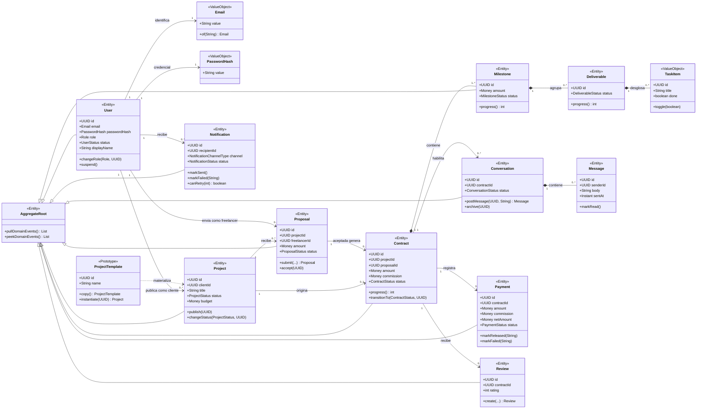
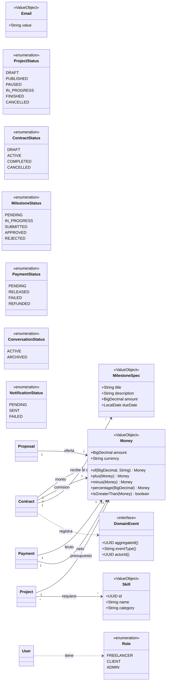

# Backend · Dominio

| Campo | Valor |
|-------|-------|
| **Módulo** | Dominio compartido y agregados de negocio |
| **Código fuente** | `src/main/java/com/freeconnect/{shared/domain,identity/domain,projects/domain,proposals/domain,contracts/domain,messaging/domain,payments/domain,reviews/domain,notifications/domain,admin/domain/report}` |
| **Propósito** | Modelar las entidades, value objects, enums y reglas invariantes del negocio sin depender de Spring, JPA ni HTTP. |

> Vista de referencia: [`docs/uml/clases-dominio.md`](../clases-dominio.md) (Fase 1). Este archivo
> añade estereotipos, patrones y trazabilidad; no reemplaza el diagrama de Fase 1.

## 1. Agregados principales

## 2. Value objects, enums y contrato de eventos

## 3. Reportes administrativos (dominio de reporte)

```mermaid
classDiagram
    direction LR

    class ReportElement {
        <<interface>>
        <<Visitable>>
        +accept(ReportVisitor) AdminReport
    }

    class ReportVisitor {
        <<interface>>
        <<Visitor>>
        +visit(ProjectReport) AdminReport
        +visit(ContractReport) AdminReport
        +visit(UserReport) AdminReport
    }

    class ProjectReport {
        <<DTO>>
        +int total
        +int published
        +Map budgets
    }

    class ContractReport {
        <<DTO>>
        +int total
        +int active
        +Map amounts
    }

    class UserReport {
        <<DTO>>
        +long total
        +long clients
        +long freelancers
    }

    class AdminReport {
        <<DTO>>
        +String report
        +Map metrics
        +Instant generatedAt
    }

    ReportElement <|.. ProjectReport
    ReportElement <|.. ContractReport
    ReportElement <|.. UserReport
    ReportVisitor ..> AdminReport : produce
    ProjectReport ..> ReportVisitor : accept
    ContractReport ..> ReportVisitor : accept
    UserReport ..> ReportVisitor : accept
```

## Patrones en este módulo

| Patrón | Rol en el módulo | Clase/archivo donde vive | Notas |
|--------|------------------|--------------------------|-------|
| Aggregate Root | Consistencia transaccional y eventos | `src/main/java/com/freeconnect/shared/domain/AggregateRoot.java:12` | Acumula `DomainEvent`; la aplicación los drena con `pullDomainEvents()`. |
| Value Object | Inmutabilidad y validación | `src/main/java/com/freeconnect/shared/domain/Money.java:11`; `src/main/java/com/freeconnect/identity/domain/Email.java:10`; `src/main/java/com/freeconnect/contracts/domain/milestone/MilestoneSpec.java:9` | `Money` normaliza escala y moneda; `Email` normaliza a minúsculas. |
| Builder | Construcción validada | `src/main/java/com/freeconnect/contracts/domain/Contract.java:260`; `src/main/java/com/freeconnect/projects/domain/Project.java:193` | `Contract.Builder.build()` valida suma de hitos ≤ monto. |
| State | Transiciones de ciclo de vida | `src/main/java/com/freeconnect/contracts/domain/state/ContractStates.java:10`; `.../projects/domain/state/ProjectStates.java:13`; `.../messaging/domain/state/ConversationStates.java:10` | El agregado delega en el registro de estados. |
| Composite | Progreso uniforme | `src/main/java/com/freeconnect/contracts/domain/composite/WorkComponent.java:12`; `.../contracts/domain/Milestone.java:23`; `.../contracts/domain/Deliverable.java:18`; `.../contracts/domain/composite/TaskItem.java:9` | `TaskItem` es hoja; `Milestone` y `Deliverable` son compuestos. |
| Prototype | Plantillas clonables | `src/main/java/com/freeconnect/projects/domain/ProjectTemplate.java:18`; `.../projects/domain/Prototype.java:9` | `copy()` genera id nuevo y copia profunda de habilidades. |
| Observer (emisor) | Eventos de dominio | `src/main/java/com/freeconnect/shared/domain/DomainEvent.java`; eventos `*Event` en cada módulo | Los agregados sólo registran eventos; no conocen listeners. |
| Factory Method (creación de agregados) | Alta de propuestas, pagos, reseñas | `src/main/java/com/freeconnect/proposals/domain/Proposal.java` (`submit`); `.../payments/domain/Payment.java:49` (`create`); `.../reviews/domain/Review.java:32` (`create`) | Fábricas estáticas que validan invariantes antes de exponer el objeto. |
| Visitor (elementos) | Reportes administrativos | `src/main/java/com/freeconnect/admin/domain/report/ReportElement.java:10`; `.../ReportVisitor.java:6` | Doble despacho; los reportes no conocen el formato de salida. |

## Notas de diseño

- **Inmutabilidad**: `Money`, `Email`, `MilestoneSpec` y `Skill` son `record` o clases sin setters.
  `Contract`, `Milestone` y `Conversation` exponen listas como `Collections.unmodifiableList(...)`.
- **Igualdad**: `Conversation` implementa `equals/hashCode` por `id` (`messaging/domain/Conversation.java:172-180`).
  Los `record` obtienen igualdad estructural por componentes.
- **Eventos**: los cambios de estado registran eventos (`ContractStatusChangedEvent`,
  `MilestoneStatusChangedEvent`, `MessageSentEvent`, `PaymentReleasedEvent`, `ReviewCreatedEvent`).
  La publicación ocurre en la capa de aplicación, no en el agregado.
- **`AdminReport` no es una entidad**: es un `record` DTO calculado por el Visitor
  (`admin/domain/report/AdminReport.java:9`). No tiene tabla ni repositorio.
- **`Role` y `UserStatus`** viven en `shared/security` e `identity/domain` respectivamente; se incluyen
  aquí porque son parte del lenguaje del dominio.
- `%% TODO: confirmar` si se añaden agregados como `Dispute`, `Invoice` o `Subscription`; hoy no existen.
