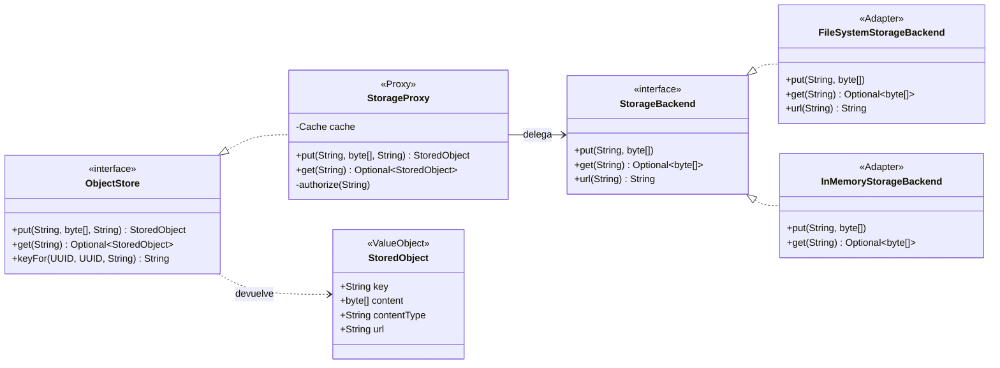
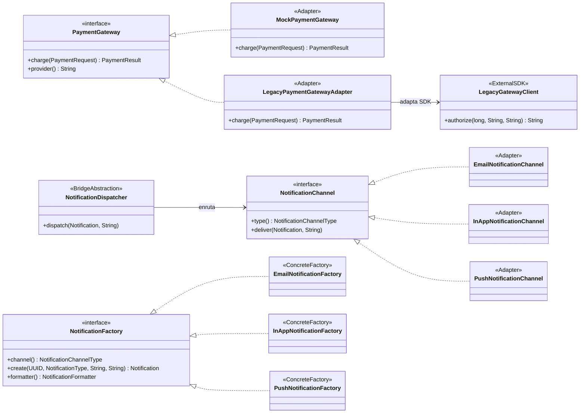

# Backend · Infraestructura

| Campo | Valor |
|-------|-------|
| **Módulo** | Configuración, adaptadores externos, almacenamiento, mensajería de notificaciones y arranque |
| **Código fuente** | `src/main/java/com/freeconnect/shared/config/`, `profiles/infrastructure/storage/`, `payments/infrastructure/gateway/`, `notifications/domain/{channel,factory}/`, `identity/infrastructure/bootstrap/` |
| **Propósito** | Implementar los puertos de dominio con tecnologías concretas y concentrar la configuración de Spring sin contaminar el negocio. |

## 1. Configuración y beans transversales

```mermaid
classDiagram
    direction LR

    class InfrastructureConfig {
        <<Configuration>>
        <<Singleton>>
        +clock() Clock
        +jsonCustomizer() Jackson2ObjectMapperBuilderCustomizer
        +notificationExecutor() Executor
        +freeConnectOpenApi() OpenAPI
    }

    class SecurityProperties {
        <<ConfigurationProperties>>
        +Jwt jwt
        +RateLimit rateLimit
        +String passwordHasher
    }

    class StorageProperties {
        <<ConfigurationProperties>>
        +String bucket
        +String endpoint
        +String publicBaseUrl
        +String provider
        +String localPath
    }

    class BootstrapProperties {
        <<ConfigurationProperties>>
        +String adminEmail
        +String adminPassword
    }

    class AdminBootstrapRunner {
        <<ApplicationRunner>>
        +run(ApplicationArguments)
    }

    class Clock
    class Executor
    class OpenAPI

    InfrastructureConfig --> SecurityProperties : habilita
    InfrastructureConfig --> StorageProperties : habilita
    InfrastructureConfig --> BootstrapProperties : habilita
    InfrastructureConfig ..> Clock : crea bean
    InfrastructureConfig ..> Executor : crea bean notificationExecutor
    InfrastructureConfig ..> OpenAPI : documenta bearerAuth
    AdminBootstrapRunner --> BootstrapProperties : lee credenciales
```

- `@EnableScheduling` (`InfrastructureConfig.java:27`) habilita el outbox de notificaciones.
- `notificationExecutor` es un `ThreadPoolTaskExecutor` con 2 hilos base, 8 máximos y cola 500
  (`:42-51`); se usa para entrega asíncrona.
- OpenAPI declara el esquema `bearerAuth` (`:53-68`), que es lo que consume Swagger UI.
- Las propiedades se enlazan como `record` (`SecurityProperties.java:10`, `StorageProperties.java:9`,
  `BootstrapProperties.java`).

## 2. Almacenamiento de objetos

- `StorageProxy` es `@Primary` (`StorageProxy.java:24-26`): todos los casos de uso ven el proxy,
  no el backend. Valida que la clave empiece por `portfolio/` y que el actor sea el dueño del
  `userId` embebido, salvo ADMIN (`:67-83`).
- Caché Caffeine de 200 entradas y 10 minutos (`:32-35`), sólo para lecturas.
- `FileSystemStorageBackend` es el backend por defecto (`matchIfMissing = true`) y sanea `..`
  para evitar traversal (`:51-57`). `InMemoryStorageBackend` sólo se activa con
  `freeconnect.storage.provider=memory`.
- **No hay adaptador S3 implementado** aunque existan `bucket`/`endpoint` en
  `StorageProperties`; el proveedor real queda pendiente. `%% TODO: confirmar` si se añadirá
  un `S3StorageBackend`.

## 3. Pagos y notificaciones

- **Pagos**: `freeconnect.payments.provider=MOCK` activa `MockPaymentGateway`
  (`MockPaymentGateway.java:14`); `LEGACY` activa `LegacyPaymentGatewayAdapter`
  (`LegacyPaymentGatewayAdapter.java:18`). El adaptador convierte `Money` decimal a centavos
  y el código del SDK a `PaymentResult`.
- **Notificaciones**: `NotificationFactoryRegistry` elige la familia por canal
  (`NotificationFactoryRegistry.java:19-24`), y `NotificationDispatcher` elige el
  implementador de entrega (`NotificationDispatcher.java:20-25`). Son dos ejes
  independientes: Abstract Factory + Bridge.
- **Canales**: `EmailNotificationChannel.java:13`, `InAppNotificationChannel.java:13`,
  `PushNotificationChannel.java:13`; todos `@Component`, sin condicionales.

## 4. Configuración por entorno

| Clave | Default | Uso |
|-------|---------|-----|
| `freeconnect.security.jwt.secret` | `freeconnect-dev-secret-...` | Firma HS256; en producción **obligatorio** `JWT_SECRET` ≥ 32 bytes (`application.yml:56-57`). |
| `freeconnect.security.jwt.access-token-ttl` | `PT15M` | Vida del access token. |
| `freeconnect.security.jwt.refresh-token-ttl` | `P7D` | Vida del refresh token. |
| `freeconnect.security.rate-limit.capacity` | `240` | Solicitudes por ventana y clave. |
| `freeconnect.security.password-hasher` | `bcrypt` | `bcrypt` o `argon2`. |
| `freeconnect.bootstrap.admin-email` | `admin@freeconnect.io` | Cuenta inicial. |
| `freeconnect.bootstrap.admin-password` | `Admin#FreeConnect2026` | Sólo para dev; debe cambiarse. |
| `freeconnect.notifications.max-attempts` | `5` | Reintentos del outbox. |
| `freeconnect.notifications.retry-delay` | `PT30S` | Backoff fijo. |
| `freeconnect.payments.provider` | `MOCK` | `MOCK` o `LEGACY`. |
| `freeconnect.payments.commission-rate` | `0.10` | Comisión por defecto. |
| `freeconnect.storage.provider` | `filesystem` | `filesystem` o `memory`. |
| `SPRING_PROFILES_ACTIVE` | `dev` | `dev`, `docker`, `test`. |
| `REDIS_HOST` / `REDIS_PORT` | `localhost:6379` | Configurados, **no usados** por código (`application.yml:24-27`). |

## Patrones en este módulo

| Patrón | Rol en el módulo | Clase/archivo donde vive | Notas |
|--------|------------------|--------------------------|-------|
| Singleton (framework) | Beans únicos | `InfrastructureConfig.java:26`; todos los `@Component`/`@Bean` | Lo garantiza Spring. |
| Adapter | Puertos ↔ tecnologías | `LegacyPaymentGatewayAdapter.java:19`; `FileSystemStorageBackend.java:15`; `EmailNotificationChannel.java:13` | El dominio no ve SDKs ni filesystem. |
| Proxy | Control de acceso + caché | `StorageProxy.java:26` | `@Primary` sobre `ObjectStore`. |
| Abstract Factory | Familias de notificación | `NotificationFactory.java:15`; `EmailNotificationFactory.java:13`, `InApp...`, `Push...` | Cada familia crea notificación + formatter. |
| Bridge | Abstracción ↔ canal | `NotificationDispatcher.java:15`; `NotificationChannel.java:12` | Canales y tipos evolucionan por separado. |
| Conditional Bean | Selección por configuración | `MockPaymentGateway.java:14`; `LegacyPaymentGatewayAdapter.java:18`; `FileSystemStorageBackend.java:14` | `@ConditionalOnProperty`. |
| Application Runner | Bootstrap de datos | `AdminBootstrapRunner.java:24` | Crea ADMIN sólo si la base está vacía. |
| Scheduler | Outbox | `NotificationOutboxProcessor.java:17` | `@Scheduled` + `maxAttempts`. |

## Notas de diseño

- **Perfiles**: `dev` usa H2 en memoria y `docker` usa PostgreSQL + Redis
  (`application-docker.yml`). La verificación de este repositorio se hizo con H2; Docker no
  está instalado en el entorno de revisión, por lo que PostgreSQL/nginx no se probaron.
- **Redis está configurado pero no se usa**: no hay `RedisTemplate`, `@Cacheable` ni
  `CacheManager` en `src/main/java`; la única caché es Caffeine en `StorageProxy`. El health
  de Redis puede reportar `DOWN` y `/actuator/health` devolver `503` sin afectar los flujos
  principales.
- **El executor de notificaciones** está definido (`InfrastructureConfig.java:42-51`) pero no se
  inyecta en ningún componente: no hay `@Async` ni referencias a `notificationExecutor` en
  `src/main/java`. La entrega del outbox ocurre por `@Scheduled`. Se documenta como bean
  disponible, no como asincronía activa.
- **Secretos**: los defaults son de desarrollo. En producción deben venir por entorno y no
  versionarse.
- **Admin bootstrap**: la contraseña se hashea al arrancar y nunca se inserta en texto claro
  en Flyway (`AdminBootstrapRunner.java:48-51`).
- **Flyway** corre con `ddl-auto: none` (`application.yml:12-23`); el esquema es
  responsabilidad de las migraciones `V1..V6`.
