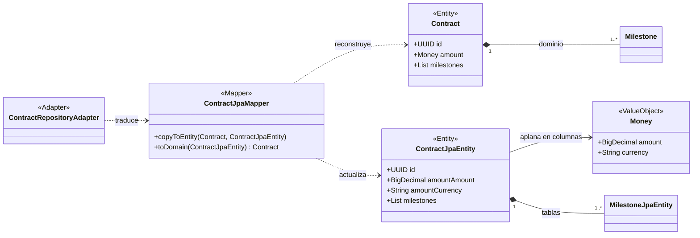

# Backend · Persistencia

| Campo | Valor |
|-------|-------|
| **Módulo** | Persistencia y adaptadores de repositorio |
| **Código fuente** | `src/main/java/com/freeconnect/*/domain/*Repository.java` y `src/main/java/com/freeconnect/*/infrastructure/persistence/` |
| **Propósito** | Traducir entre agregados de dominio y el modelo relacional (JPA/Hibernate) sin filtrar detalles de persistencia a la capa de aplicación. |

## 1. Rebanada representativa (proyectos y contratos)

```mermaid
classDiagram
    direction LR

    class ProjectRepository {
        <<interface>>
        <<Repository>>
        +save(Project) Project
        +findById(UUID) Optional
        +search(ProjectSearchCriteria) PagedResult
        +findByClient(UUID) List
        +findAll() List
    }

    class ProjectJpaRepository {
        <<interface>>
        <<Repository>>
        <<SpringData>>
        +findByClientIdOrderByCreatedAtDesc(UUID) List
        +countByStatus(ProjectStatus) long
        +findByCreatedAtAfter(Instant) List
    }

    class ProjectRepositoryAdapter {
        <<Repository>>
        <<Adapter>>
        +save(Project) Project
        +findById(UUID) Optional
        +search(ProjectSearchCriteria) PagedResult
    }

    class ProjectJpaEntity {
        <<Entity>>
        <<JpaEntity>>
        +UUID id
        +UUID clientId
        +String title
        +ProjectStatus status
        +BigDecimal budgetAmount
        +String budgetCurrency
        +Set skillIds
    }

    class ProjectSpecifications {
        <<Specification>>
        +from(ProjectSearchCriteria, SkillCatalog) Specification
        +interpret(ProjectFilterExpression, SkillCatalog) Specification
    }

    class ContractRepository {
        <<interface>>
        <<Repository>>
        +save(Contract) Contract
        +findById(UUID) Optional
        +findByClient(UUID) List
        +findByFreelancer(UUID) List
        +existsByProposal(UUID) boolean
        +findAll() List
    }

    class ContractJpaRepository {
        <<interface>>
        <<Repository>>
        <<SpringData>>
        +findByClientIdOrderByCreatedAtDesc(UUID) List
        +findByFreelancerIdOrderByCreatedAtDesc(UUID) List
        +existsByProposalId(UUID) boolean
    }

    class ContractRepositoryAdapter {
        <<Repository>>
        <<Adapter>>
        +save(Contract) Contract
        +findById(UUID) Optional
    }

    class ContractJpaMapper {
        <<Mapper>>
        +copyToEntity(Contract, ContractJpaEntity)
        +toDomain(ContractJpaEntity) Contract
    }

    class ContractJpaEntity {
        <<Entity>>
        <<JpaEntity>>
        +UUID id
        +UUID projectId
        +UUID proposalId
        +ContractStatus status
        +BigDecimal amountAmount
        +String amountCurrency
    }

    class MilestoneJpaEntity {
        <<Entity>>
        <<JpaEntity>>
        +UUID id
        +UUID contractId
        +MilestoneStatus status
    }

    class DeliverableJpaEntity {
        <<Entity>>
        <<JpaEntity>>
        +UUID id
        +UUID milestoneId
        +DeliverableStatus status
    }

    class TaskItemJpaEntity {
        <<Entity>>
        <<JpaEntity>>
        +UUID id
        +UUID deliverableId
        +boolean done
    }

    ProjectRepository <|.. ProjectRepositoryAdapter : implementa
    ProjectRepositoryAdapter --> ProjectJpaRepository : delega
    ProjectRepositoryAdapter ..> ProjectJpaEntity : mapea
    ProjectRepositoryAdapter ..> ProjectSpecifications : usa
    ProjectJpaRepository ..> ProjectJpaEntity : gestiona

    ContractRepository <|.. ContractRepositoryAdapter : implementa
    ContractRepositoryAdapter --> ContractJpaRepository : delega
    ContractRepositoryAdapter ..> ContractJpaMapper : usa
    ContractJpaMapper ..> ContractJpaEntity : mapea
    ContractJpaRepository ..> ContractJpaEntity : gestiona
    ContractJpaEntity "1" *-- "1..*" MilestoneJpaEntity : contiene
    MilestoneJpaEntity "1" *-- "0..*" DeliverableJpaEntity : agrupa
    DeliverableJpaEntity "1" *-- "0..*" TaskItemJpaEntity : desglosa
```

## 2. Mapa de repositorios por módulo

| Módulo | Puerto de dominio (`<<Repository>>`) | Spring Data (`JpaRepository<T, ID>`) | Adaptador (`<<Adapter>>`) | Entidad JPA principal |
|--------|--------------------------------------|-------------------------------------|---------------------------|-----------------------|
| Identidad | `identity/domain/UserRepository.java` | `identity/infrastructure/persistence/UserJpaRepository.java` | `UserRepositoryAdapter.java` | `UserJpaEntity.java` |
| Identidad (refresh) | `identity/application/RefreshTokenService.java` | `RefreshTokenJpaRepository.java` | `RefreshTokenRepositoryAdapter.java` | `RefreshTokenJpaEntity.java` |
| Proyectos | `projects/domain/ProjectRepository.java:11` | `ProjectJpaRepository.java:9` (+ `JpaSpecificationExecutor`) | `ProjectRepositoryAdapter.java:28` | `ProjectJpaEntity.java` |
| Propuestas | `proposals/domain/ProposalRepository.java` | `ProposalJpaRepository.java` | `ProposalRepositoryAdapter.java` | `ProposalJpaEntity.java` |
| Contratos | `contracts/domain/ContractRepository.java` | `ContractJpaRepository.java:10` | `ContractRepositoryAdapter.java:14` | `ContractJpaEntity.java` |
| Mensajería | `messaging/domain/ConversationRepository.java` | `ConversationJpaRepository.java` | `ConversationRepositoryAdapter.java` | `ConversationJpaEntity.java`, `ConversationMessageJpaEntity.java` |
| Pagos | `payments/domain/PaymentRepository.java` | `PaymentJpaRepository.java` | `PaymentRepositoryAdapter.java` | `PaymentJpaEntity.java` |
| Reseñas | `reviews/domain/ReviewRepository.java` | `ReviewJpaRepository.java` | `ReviewRepositoryAdapter.java` | `ReviewJpaEntity.java` |
| Notificaciones | `notifications/domain/NotificationRepository.java` | `NotificationJpaRepository.java` | `NotificationRepositoryAdapter.java` | `NotificationJpaEntity.java` |
| Perfiles | `profiles/domain/ProfileRepository.java`, `SkillRepository.java` | `ProfileJpaRepository.java`, `SkillJpaRepository.java`, `PortfolioItemJpaRepository.java` | `ProfileRepositoryAdapter.java`, `SkillRepositoryAdapter.java` | `ProfileJpaEntity.java`, `SkillJpaEntity.java`, `PortfolioItemJpaEntity.java` |
| Auditoría | `shared/audit/AuditRecorder.java` (puerto de escritura) | `AuditLogJpaRepository.java` | `JpaAuditRecorder.java:19` | `AuditLogJpaEntity.java` |

> **Repositorios custom**: el único caso de consulta dinámica es
> `ProjectSpecifications` (`<<Specification>>`), que combina criterios y el AST del
> filtro con `JpaSpecificationExecutor`. El resto usa *query derivation* de Spring
> Data (`findBy...`, `existsBy...`, `countBy...`). No hay `@Query` ni `EntityManager`
> inyectado en adaptadores.

## 3. Mapeo dominio ↔ JPA

- `Money` se **aplana** en columnas `*_amount` / `*_currency`; no hay `@Embeddable` para dinero.
- `ContractJpaMapper` es `final` y *package-private* (`contracts/infrastructure/persistence/ContractJpaMapper.java:22`);
  sincroniza hijos por identificador para no recrear filas.
- `ProjectRepositoryAdapter` reconstruye el agregado con `Project.builder(...)` y resuelve
  habilidades vía `SkillCatalog` (`ProjectRepositoryAdapter.java:86-105`).
- `ProfileViewMapper` (`profiles/application/ProfileViewMapper.java:17`) no es persistencia: es un
  `<<Mapper>>` de aplicación hacia `ProfileView`.

## Patrones en este módulo

| Patrón | Rol en el módulo | Clase/archivo donde vive | Notas |
|--------|------------------|--------------------------|-------|
| Repository (puerto) | Contrato de persistencia del dominio | `projects/domain/ProjectRepository.java:11`; `contracts/domain/ContractRepository.java` | El dominio no conoce JPA. |
| Adapter | Traduce puerto ↔ Spring Data | `projects/infrastructure/persistence/ProjectRepositoryAdapter.java:28`; `contracts/infrastructure/persistence/ContractRepositoryAdapter.java:14` | Todos los `*RepositoryAdapter`. |
| Mapper | Dominio ↔ entidad JPA | `contracts/infrastructure/persistence/ContractJpaMapper.java:22` | Mapper estático, sin estado. |
| Specification | Consulta dinámica | `projects/infrastructure/persistence/ProjectSpecifications.java:27` | Combina criterios con `Specification::and`. |
| Interpreter (traducción) | AST → SQL | `ProjectSpecifications.interpret(...)` (`:64`) | La misma expresión se evalúa en memoria y en JPA. |
| Repository de framework | CRUD y query derivation | `ProjectJpaRepository.java:9`; `ContractJpaRepository.java:10` | `JpaRepository<T, ID>` es infraestructura del framework. |
| Unit of Work (implícito) | Transacciones | `@Transactional` en casos de uso | No hay clase `UnitOfWork`; lo aporta Spring. Estado: **framework**. |

## Notas de diseño

- **Una entidad JPA por tabla**, no por agregado: `ContractJpaEntity` contiene hitos,
  entregables, tareas y comentarios como colecciones.
- **No se usan relaciones JPA ricas** entre módulos; se guardan `UUID` foráneos y se resuelven
  por repositorio. Esto reduce acoplamiento y facilita el monolito modular.
- **Optimistic locking**: el manejador global traduce `OptimisticLockingFailureException`
  (`shared/api/GlobalExceptionHandler.java:66-71`), pero la anotación `@Version` debe confirmarse
  entidad por entidad. `%% TODO: confirmar` cobertura de `@Version` en todas las tablas.
- **Migraciones**: Flyway `V1..V6` en `src/main/resources/db/migration`. El esquema no se genera
  con `hibernate.ddl-auto` en entornos reales.
- **H2 en dev/test**, PostgreSQL en Docker. La persistencia no se verificó contra PostgreSQL
  porque Docker no está instalado en el entorno de revisión.
