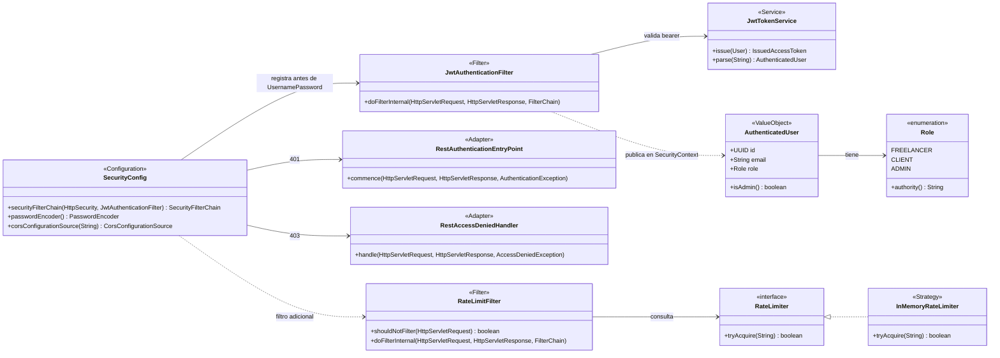
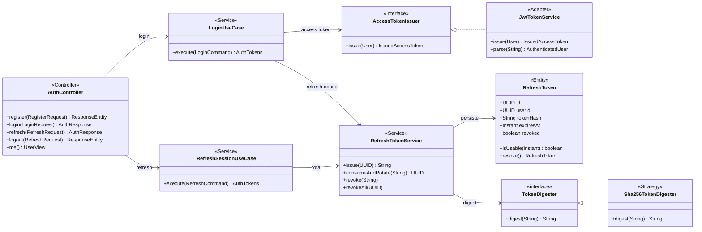
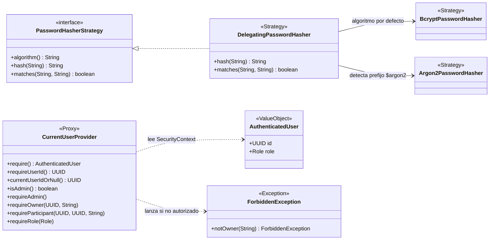

# Backend · Seguridad

| Campo | Valor |
|-------|-------|
| **Módulo** | Autenticación, autorización, sesiones y protección de endpoints |
| **Código fuente** | `src/main/java/com/freeconnect/identity/infrastructure/security/`, `identity/application/RefreshTokenService.java`, `src/main/java/com/freeconnect/shared/security/`, `shared/ratelimit/` |
| **Propósito** | Emitir y validar credenciales, aplicar roles y verificar propiedad de recursos sin acoplar el dominio a Spring Security. |

## 1. Cadena de seguridad

Reglas efectivas (`SecurityConfig.java:56-60`):

| Regla | Efecto |
|-------|--------|
| `PUBLIC_ENDPOINTS` (`:30-39`) | Registro, login, refresh, OpenAPI, Swagger, health y consola H2. |
| `GET /api/v1/projects/**` (`:58`) | Catálogo público de proyectos. |
| `/api/v1/admin/**` (`:59`) | **`hasRole("ADMIN")`**. |
| `anyRequest()` (`:60`) | Autenticado. |

> **Doble protección del panel admin.** Además de `:59`, `AdminController.java:27`
> y `AuditController.java:19` llevan `@PreAuthorize("hasRole('ADMIN')")` **a nivel de
> clase**, y los métodos vuelven a comprobar `requireAdmin()`
> (`AdminController.java:41`, `AuditController.java:34`). Si mañana se añade un
> endpoint admin, hereda la restricción sin tocar la configuración.

## 2. Sesiones y tokens

- **Access token**: JWT HS256 con `sub`, `email`, `role`, `iss`, `iat`, `exp`
  (`JwtTokenService.java:46-54`). El secreto debe tener ≥ 32 bytes o el arranque falla
  (`:35-37`).
- **Refresh token**: opaco, 48 bytes aleatorios en Base64 URL (`RefreshTokenService.java:36-38`);
  sólo se guarda su digest SHA-256 (`:40`, `Sha256TokenDigester.java:19-20`).
- **Rotación**: `consumeAndRotate` revoca el token usado y devuelve el `userId`
  (`RefreshTokenService.java:45-56`). Un refresh reutilizado deja de ser válido.
- **Logout**: revoca el refresh token recibido (`AuthController.java:84-86`).
- **Stateless**: `SessionCreationPolicy.STATELESS` (`SecurityConfig.java:52`), sin `HttpSession`.

## 3. Contraseñas y autorización de recursos

- `DelegatingPasswordHasher` es `@Primary` (`DelegatingPasswordHasher.java:16-18`) y elige el
  algoritmo con `freeconnect.security.password-hasher` (`:28`). La verificación detecta el
  prefijo `$argon2` para permitir migraciones graduales (`:42-49`).
- `SecurityConfig` también expone un `PasswordEncoder` de Spring
  (`PasswordEncoderFactories.createDelegatingPasswordEncoder()`, `:68-72`), pero el dominio
  usa el puerto `PasswordHasherStrategy`.
- `CurrentUserProvider` encapsula `SecurityContextHolder` y ofrece guardas de **propiedad**
  (`requireOwner`) y **participación** (`requireParticipant`) que los casos de uso invocan.
  Un `ADMIN` siempre pasa (`:55`, `:63`).
- `Role.authority()` prefija `ROLE_` (`Role.java:11-13`), que es lo que espera `hasRole(...)`.

## 4. Protección transversal

| Mecanismo | Dónde | Efecto |
|-----------|-------|--------|
| JWT corto | `JwtTokenService.java:46-54` | El access token caduca según `freeconnect.security.jwt.access-token-ttl`. |
| Refresh rotatorio | `RefreshTokenService.java:45-56` | Un refresh usado se revoca. |
| Hash adaptativo | `DelegatingPasswordHasher.java:37-49` | BCrypt por defecto; Argon2 soportado. |
| Autorización por método | `@PreAuthorize` en controladores | `hasRole('ADMIN')`, `hasRole('CLIENT')`, `hasRole('FREELANCER')`, `isAuthenticated()`. |
| Autorización por recurso | `CurrentUserProvider.requireOwner/requireParticipant` | Evita IDOR entre clientes/freelancers. |
| Rate limiting | `RateLimitFilter.java:37-55` | `429` por usuario autenticado o IP. |
| CORS | `SecurityConfig.java:74-86` | Orígenes configurables por `FREECONNECT_CORS_ALLOWED_ORIGINS`. |
| Errores uniformes | `RestAuthenticationEntryPoint`, `RestAccessDeniedHandler` | `401`/`403` con `ErrorResponse`. |
| H2 console | `SecurityConfig.java:38` + `frameOptions.sameOrigin()` (`:54`) | Sólo disponible en perfil dev. |

## Patrones en este módulo

| Patrón | Rol en el módulo | Clase/archivo donde vive | Notas |
|--------|------------------|--------------------------|-------|
| Filter Chain | Cadena HTTP de seguridad | `SecurityConfig.java:41-65` | El patrón lo ejecuta Spring Security. Estado: **framework**. |
| Template Method | Filtros de una sola pasada | `JwtAuthenticationFilter.java:21`; `RateLimitFilter.java:25` | `OncePerRequestFilter` define el esqueleto; `doFilterInternal` es el hook. |
| Strategy | Hashing y rate limiting | `PasswordHasherStrategy.java:9`; `DelegatingPasswordHasher.java:18`; `RateLimiter.java`; `InMemoryRateLimiter.java:18` | Intercambiables sin tocar casos de uso. |
| Proxy | Acceso tipado al actor | `CurrentUserProvider.java:17` | Oculta `SecurityContextHolder` y centraliza guardas. |
| Adapter | Errores de seguridad → JSON | `RestAuthenticationEntryPoint`; `RestAccessDeniedHandler` | Traducen el ciclo de Spring Security al contrato de la API. |
| Value Object | Identidad autenticada | `AuthenticatedUser.java:9` | `record` inmutable; nunca contiene contraseña. |
| Singleton (framework) | Beans de seguridad | `@Component`/`@Bean` | Una instancia por contenedor. Estado: **framework**. |

## Notas de diseño

- **El JWT no se revoca**: al ser stateless, un access token robado sigue siendo válido hasta
  su expiración corta. La revocación real ocurre en el refresh token.
- **`JwtAuthenticationFilter` limpia el contexto ante cualquier fallo** (`:44-46`) y deja que
  la cadena decida si el endpoint es público; no lanza `401` por sí mismo.
- **CSRF deshabilitado** (`:47`) es correcto para una API stateless con bearer token; no hay
  cookies de sesión.
- **CORS**: el valor por defecto del `@Value` (`:76`) no incluye `http://localhost:5173`; en
  desarrollo hay que definir `FREECONNECT_CORS_ALLOWED_ORIGINS`. El arranque usado en la
  verificación incluye `5173`, `3000` y `8080`.
- **Rate limit en memoria**: no se comparte entre instancias. Con varias réplicas haría falta
  un backend distribuido (Redis), hoy ausente. `%% TODO: confirmar` estrategia para producción.
- **La consola H2** está en `PUBLIC_ENDPOINTS`; sólo debe existir en dev. `%% TODO: confirmar`
  que el perfil de producción la excluya.
- **`ADMIN` no puede registrarse públicamente**: `RegisterRequest.role` acepta el enum, pero
  `RegisterUserUseCase.validate(...)` rechaza `null` y `Role.ADMIN`
  (`identity/application/RegisterUserUseCase.java:34-37`). El ADMIN inicial sólo lo crea
  `AdminBootstrapRunner`.
