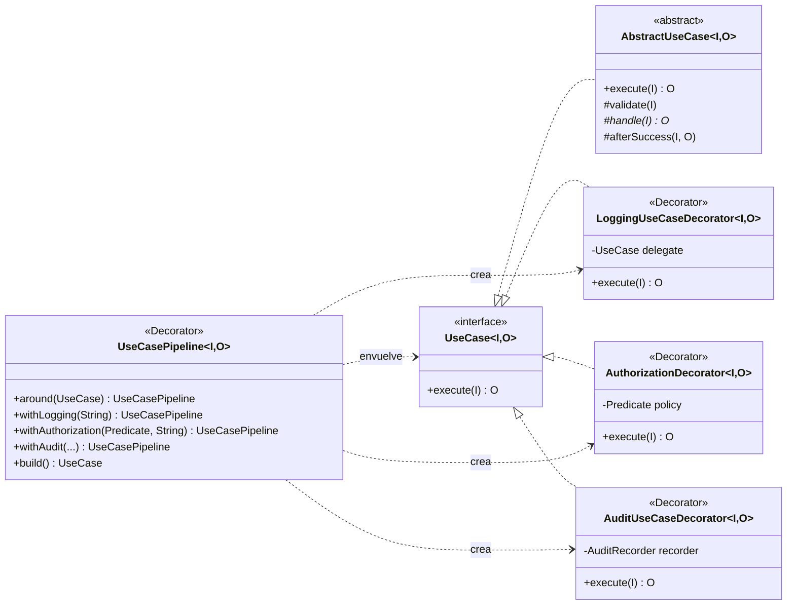
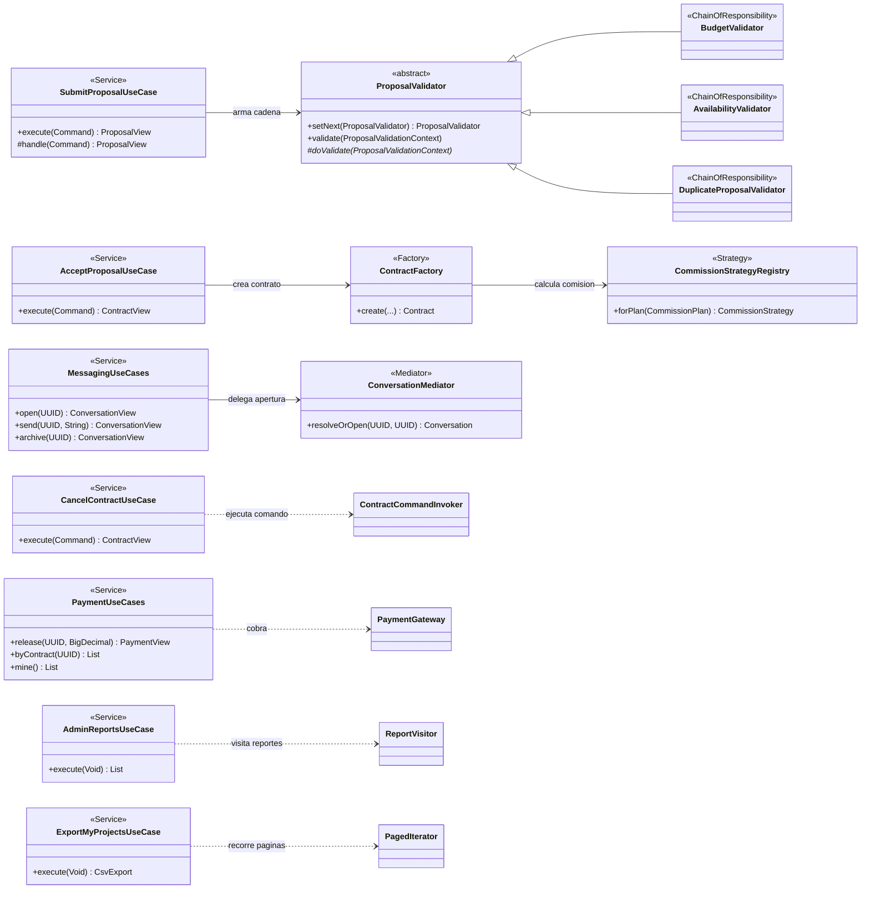
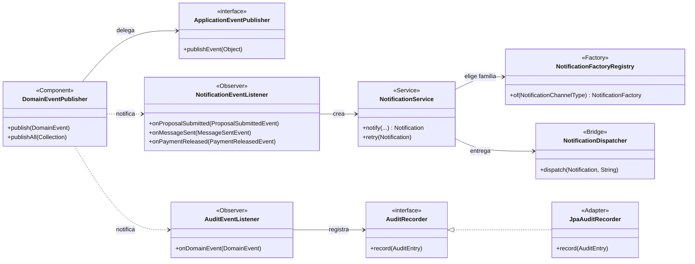

# Backend · Servicios y casos de uso

| Campo | Valor |
|-------|-------|
| **Módulo** | Capa de aplicación: casos de uso, servicios de dominio y orquestación |
| **Código fuente** | `src/main/java/com/freeconnect/*/application/`, `src/main/java/com/freeconnect/shared/application/`, `src/main/java/com/freeconnect/shared/decorator/`, `src/main/java/com/freeconnect/shared/event/` |
| **Propósito** | Orquestar agregados, puertos y eventos para ejecutar los casos de uso sin que los controladores conozcan el dominio. |

## 1. Esqueleto de casos de uso

> **Estado real:** el pipeline de decoradores está implementado pero **no cableado**:
> no se encontró ninguna llamada a `UseCasePipeline` en `src/main` ni en `src/test`.
> La autorización efectiva ocurre en `@PreAuthorize` + `CurrentUserProvider`, y la
> auditoría por eventos (`AuditEventListener`). Se documenta para no confundir
> "existe" con "está en uso".

## 2. Casos de uso por módulo (selección representativa)

## 3. Colaboración transversal (eventos y puertos)

## Patrones en este módulo

| Patrón | Rol en el módulo | Clase/archivo donde vive | Notas |
|--------|------------------|--------------------------|-------|
| Template Method | Esqueleto de caso de uso | `shared/application/AbstractUseCase.java:10` | `execute()` = `validate → handle → afterSuccess`. |
| Command (contrato de entrada) | Comando/query como record | `SubmitProposalUseCase.Command` (`:76`); `CancelContractUseCase.Command` (`:46`) | Cada caso de uso define su propio `record Command`. |
| Decorator | Logging/autorización/auditoría | `shared/decorator/UseCasePipeline.java:13` y tres decoradores | **No cableado** en producción. |
| Strategy | Comisión, hashing, rate limit | `contracts/domain/commission/CommissionStrategy.java:12`; `contracts/application/CommissionStrategyRegistry.java:17`; `identity/domain/PasswordHasherStrategy.java:9` | Selección por plan o algoritmo. |
| Factory Method | Creación de contratos e hitos | `contracts/application/ContractFactory.java:23`; `contracts/domain/milestone/MilestoneFactory.java:21` | `MilestoneFactory` decide `SINGLE/EQUAL_SPLIT/CUSTOM`. |
| Chain of Responsibility | Validación de propuestas | `proposals/domain/validation/ProposalValidator.java:9`; cadena en `SubmitProposalUseCase.java:65-67` | `Budget → Availability → Duplicate`. |
| Mediator | Apertura de conversaciones | `messaging/application/ConversationMediator.java:21` | Resuelve contrato, participantes y reutilización. |
| Observer | Eventos de dominio | `shared/event/DomainEventPublisher.java:18`; `notifications/application/NotificationEventListener.java:27`; `audit/application/AuditEventListener.java:18` | Listeners síncronos; los fallos de notificación se capturan. |
| Abstract Factory + Bridge | Notificaciones | `notifications/domain/factory/NotificationFactory.java:15`; `notifications/domain/channel/NotificationChannel.java:12`; `notifications/application/NotificationDispatcher.java:15` | Familias por canal + entrega desacoplada. |
| Facade de aplicación | Agrupa casos de uso | `payments/application/PaymentUseCases.java:28`; `messaging/application/MessagingUseCases.java:17`; `notifications/application/NotificationService.java:20` | El controlador depende de una sola fachada. |
| Iterator | Exportación paginada | `shared/pagination/PagedIterator.java:17`; `projects/application/ExportMyProjectsUseCase.java:41` | `PageLoader` desacopla el repositorio. |
| Visitor | Reportes | `admin/application/AdminReportsUseCase.java:78-80`; `StatisticsReportVisitor.java:16` | La lista de elementos se visita con un visitor. |
| Outbox | Reintento de notificaciones | `notifications/application/NotificationOutboxProcessor.java:17` | `@Scheduled` + `attempts`; no es Observer estricto. |

## Notas de diseño

- **Autorización en profundidad**: los controladores declaran roles (`@PreAuthorize`), los casos de uso
  verifican propiedad/participación (`CurrentUserProvider.requireOwner/requireParticipant`) y el dominio
  valida transiciones. No se depende de una sola capa.
- **Eventos después de persistir**: los casos de uso guardan el agregado y luego publican
  `saved.pullDomainEvents()`. Así los listeners ven el estado persistido.
- **Transacciones**: `@Transactional` en los métodos de caso de uso. Los listeners corren en la misma
  transacción; por eso `NotificationEventListener` captura excepciones con `safe(...)` para no romper
  la operación de negocio.
- **`AbstractUseCase` no es obligatorio**: varios casos implementan `UseCase` directamente
  (`CancelContractUseCase`, `AdminReportsUseCase`). El patrón se usa donde hay pasos comunes.
- **Deuda**: cablear o eliminar `UseCasePipeline`; hoy es código muerto desde el punto de vista de
  ejecución. `%% TODO: confirmar` si se planea activar por configuración.
