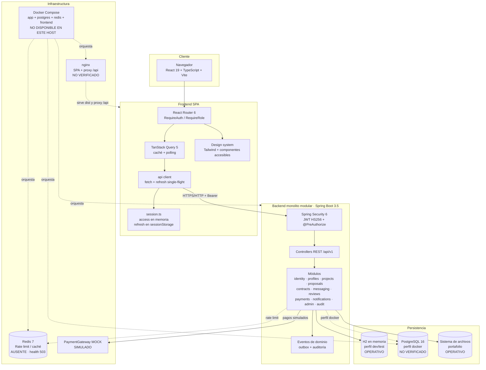

# Componentes de alto nivel

Vista de contenedores y dependencias externas. El estado operativo refleja lo
verificado en este entorno de desarrollo (H2 en memoria, sin Redis ni Docker).

## Estado operativo verificado

| Componente | Estado | Evidencia / nota |
|------------|--------|------------------|
| SPA React + Vite | ✅ Operativo | `npm run build`, `npm run test` y Playwright E2E en local. |
| API Spring Boot (perfil `dev`) | ✅ Operativo | Flujo E2E completo contra `http://localhost:8080/api/v1`. |
| H2 en memoria | ✅ Operativo | Datos efímeros; se reinicia al reiniciar el backend. |
| PostgreSQL 16 | ⚠️ No verificado | Definido en `docker-compose.yml`; sin Docker local. |
| Redis 7 | ❌ Ausente | `/actuator/health` degradado (503); el rate limit del MVP es en memoria. |
| nginx (frontend) | ⚠️ No verificado | `frontend/nginx.conf` y `Dockerfile` existen; no se construyó la imagen. |
| Docker Compose | ❌ No disponible | `docker` no está instalado en este host. |
| Pasarela de pagos | 🟡 Simulada | `PAYMENT_PROVIDER=MOCK`; sin cobros reales. |
| Almacenamiento de portafolio | ✅ Operativo | Sistema de archivos; `ObjectStore` listo para S3/MinIO. |
| WebSockets | ❌ No implementado | Mensajería y notificaciones usan polling configurable. |

## Decisiones de arquitectura relevantes

- **Monolito modular** con Clean Architecture por módulo (`domain`, `application`, `infrastructure`, `api`).
- **Estado y reglas** en el dominio (`Project`, `Proposal`, `Contract`, `Milestone`), no en controladores.
- **Seguridad stateless**: el servidor no guarda sesión; el JWT se valida en cada petición.
- **Errores uniformes**: `{timestamp,status,code,message,path,details}`; el cliente también acepta RFC 7807.
- **Outbox de notificaciones** y auditoría desacopladas del request principal.

> `%% TODO: confirmar` la topología definitiva de caché si se activa Redis en producción;
> hoy la caché del MVP usa Caffeine en proceso.
