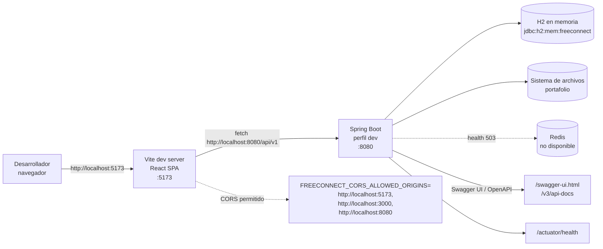
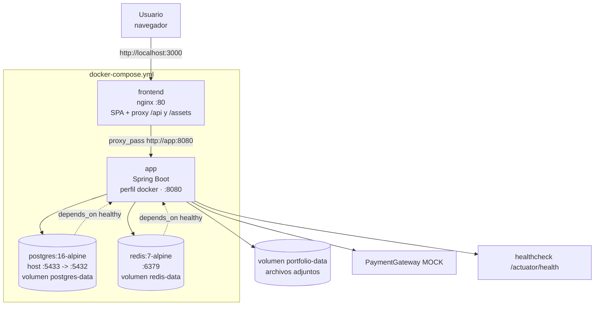

# Despliegue

Dos escenarios: el **local** realmente utilizado para desarrollar y ejecutar los
E2E, y el **objetivo con Docker**, que está declarado pero **no se verificó en este
entorno** porque Docker no está instalado.

## Local (verificado)



### Arranque local

```powershell
# Terminal 1 — backend con CORS para Vite y E2E
$env:FREECONNECT_CORS_ALLOWED_ORIGINS="http://localhost:5173,http://localhost:3000,http://localhost:8080"
mvn spring-boot:run

# Terminal 2 — frontend
cd frontend
npm run dev
```

- API: <http://localhost:8080/api/v1>
- Swagger: <http://localhost:8080/swagger-ui.html>
- H2 console: <http://localhost:8080/h2-console>
- Frontend: <http://localhost:5173>
- Health: <http://localhost:8080/actuator/health>

> El perfil `dev` usa H2 en memoria: cada reinicio borra datos y vuelve a sembrar
> la cuenta `admin@freeconnect.io`.

## Docker (objetivo, no verificado)



### Componentes declarados

| Servicio | Imagen / build | Puerto host | Estado |
|----------|----------------|-------------|--------|
| `frontend` | `frontend/Dockerfile` (multi-stage Node + nginx) | `3000 -> 80` | ⚠️ No verificado |
| `app` | `Dockerfile` multi-stage Maven + JRE | `8080` | ⚠️ No verificado |
| `postgres` | `postgres:16-alpine` | `5433 -> 5432` | ⚠️ No verificado |
| `redis` | `redis:7-alpine` | `6379` | ⚠️ No verificado |

### Variables y proxy

- El frontend se construye con `VITE_API_BASE_URL=/api/v1` para evitar CORS.
- `nginx.conf` sirve `index.html` para rutas SPA y hace proxy de `/api/` y `/assets/` a `app:8080`.
- El backend en Docker usa `SPRING_PROFILES_ACTIVE=docker`, `DATABASE_URL` y Flyway.
- **No se modificaron** `docker-compose.yml`, `Dockerfile` ni `nginx.conf` en esta fase.

### Limitación de verificación

```text
> docker version
docker: The term 'docker' is not recognized...
```

Por tanto, el build de contenedores, las migraciones Flyway sobre PostgreSQL real y
el proxy de nginx quedan como **pendientes de verificación**. El despliegue local sí
está validado con build, tests unitarios y E2E Playwright.

## Matriz de entornos

| Aspecto | Local | Docker objetivo |
|---------|-------|-----------------|
| Base de datos | H2 en memoria | PostgreSQL 16 |
| Migraciones | Hibernate / H2 | Flyway (`V1..V6`) |
| CORS | Necesario (5173 → 8080) | Innecesario (mismo origen vía nginx) |
| Refresh token | `sessionStorage` | `sessionStorage` (misma SPA) |
| Redis | Ausente (health 503) | Declarado con healthcheck |
| Pagos | Mock | Mock |
| Verificado | ✅ | ❌ |
