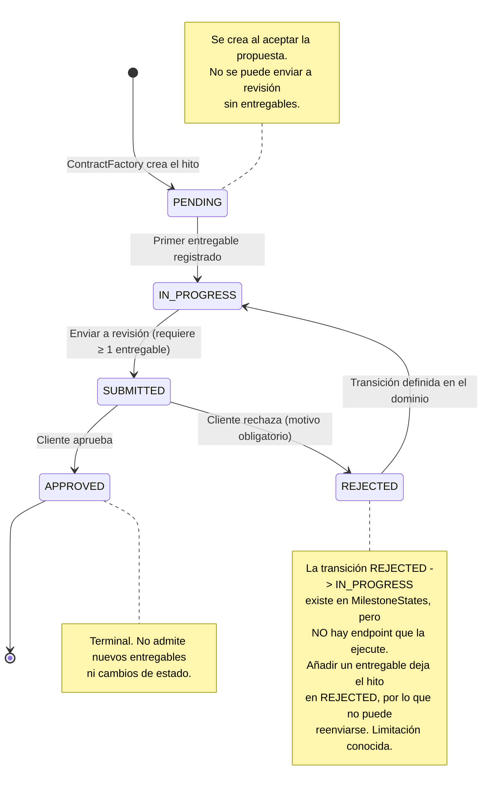
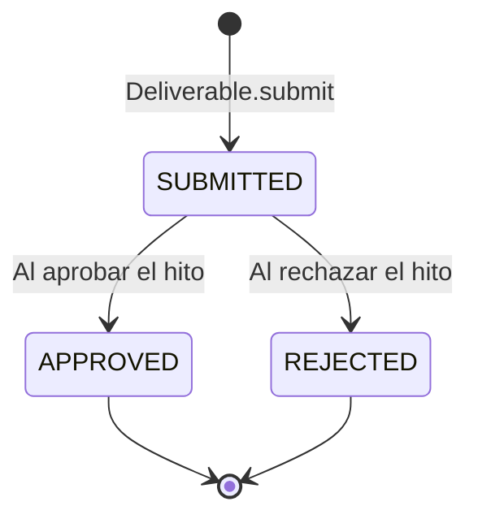
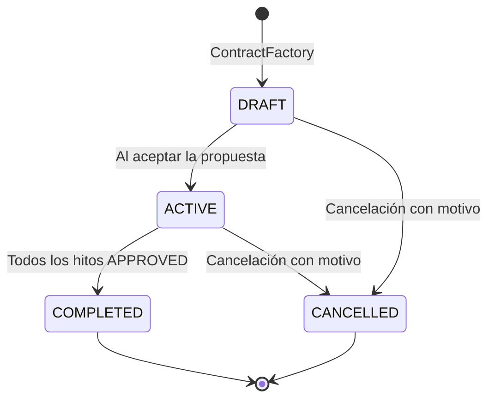

# Estados del hito

Máquina de estados implementada en `MilestoneStates` y aplicada por
`Milestone.transitionTo`. El estado del entregable y del contrato se incluyen como
contexto porque condicionan las acciones disponibles.

## Ciclo de vida del hito

## Reglas de transición

| Desde | Hacia permitidos | Disparador |
|-------|------------------|------------|
| `PENDING` | `IN_PROGRESS` | `POST .../deliverables` (primer entregable) |
| `IN_PROGRESS` | `SUBMITTED` | `POST .../submit` con al menos un entregable |
| `SUBMITTED` | `APPROVED` | `POST .../approve` (solo cliente) |
| `SUBMITTED` | `REJECTED` | `POST .../reject` con motivo (solo cliente) |
| `REJECTED` | `IN_PROGRESS` | Definido en el dominio, **sin endpoint** |
| `APPROVED` | — | Terminal |

Errores de dominio esperados:

- `MILESTONE_WITHOUT_DELIVERABLES` (409) al enviar sin entregables.
- `INVALID_MILESTONE_TRANSITION` (409) al aprobar/rechazar fuera de `SUBMITTED`.
- `MILESTONE_CLOSED` (409) al añadir entregables a un hito `APPROVED`.

## Entregable (contexto)

> El entregable nace directamente en `SUBMITTED`; el enum conserva `DRAFT` para
> compatibilidad, pero el flujo actual no lo usa.

## Contrato (contexto)

## Limitación conocida: reenvío de hitos rechazados

El dominio permite `REJECTED → IN_PROGRESS`, pero no existe un endpoint que ejecute
esa transición. En la práctica:

1. El cliente rechaza el hito (`SUBMITTED → REJECTED`).
2. El freelancer añade un nuevo entregable; `addDeliverable` **no** cambia el estado
   porque solo promueve desde `PENDING`.
3. El hito permanece `REJECTED` y `submit` no es válido desde ese estado.

La UI lo advierte. Se propone añadir `POST .../milestones/{id}/reopen` o permitir
`submit` desde `REJECTED`. Esta limitación también está documentada en
[`frontend/README.md`](../../frontend/README.md).
