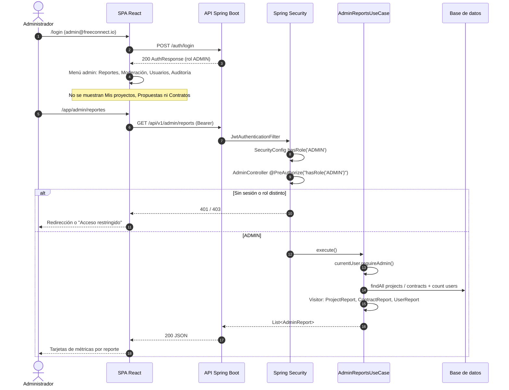
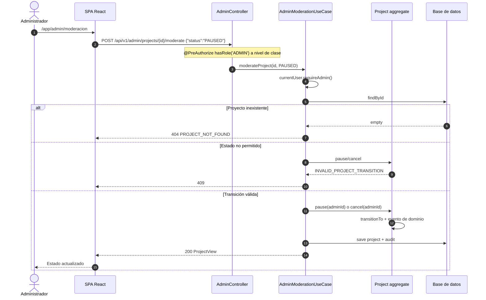
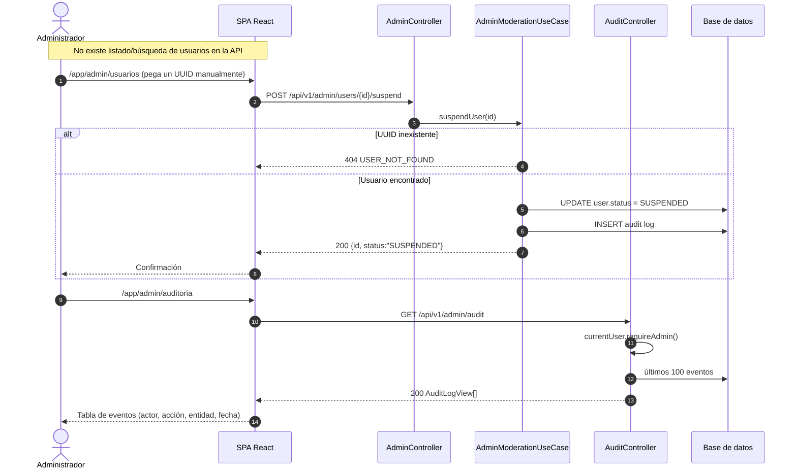

# Secuencia de administración

Panel de solo lectura y moderación. **Todo** `/api/v1/admin/**` está protegido por
`hasRole('ADMIN')` en `SecurityConfig` y, además, por `@PreAuthorize("hasRole('ADMIN')")`
a nivel de clase en `AdminController` y `AuditController`. Esta nota sustituye a la
afirmación anterior de que los reportes eran públicos.

## Acceso y reportes

## Moderación de proyectos

> La moderación solo acepta `PAUSED` o `CANCELLED`; cualquier otro estado devuelve
> `ValidationException`. Las transiciones legales dependen del estado actual del proyecto.

## Suspensión de usuarios y auditoría

## Límites conocidos del panel

| Límite | Efecto | Mitigación actual |
|--------|--------|-------------------|
| No hay `GET /admin/users` | La suspensión exige pegar el UUID. | La UI advierte y valida el formato. |
| No hay reactivación | Un usuario suspendido no puede rehabilitarse por API. | Fuera de alcance del MVP. |
| El admin no es parte de contratos | No puede abrir el detalle de contrato ni el perfil público. | Navegación admin acotada a sus cuatro secciones. |
| Los reportes son agregados | No hay exportación ni series temporales. | Se muestran métricas y fecha de generación. |
| Auditoría limitada | Solo los últimos 100 eventos. | Suficiente para el prototipo académico. |
