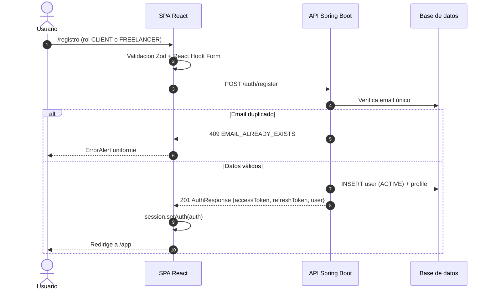
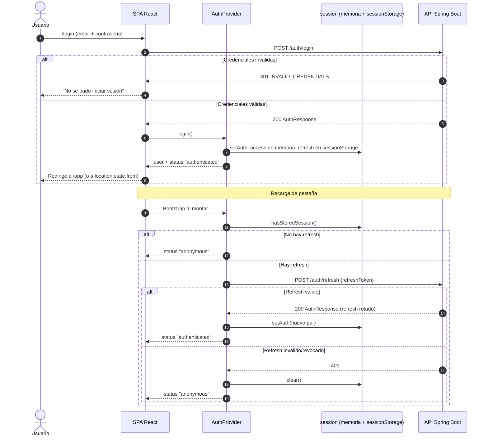
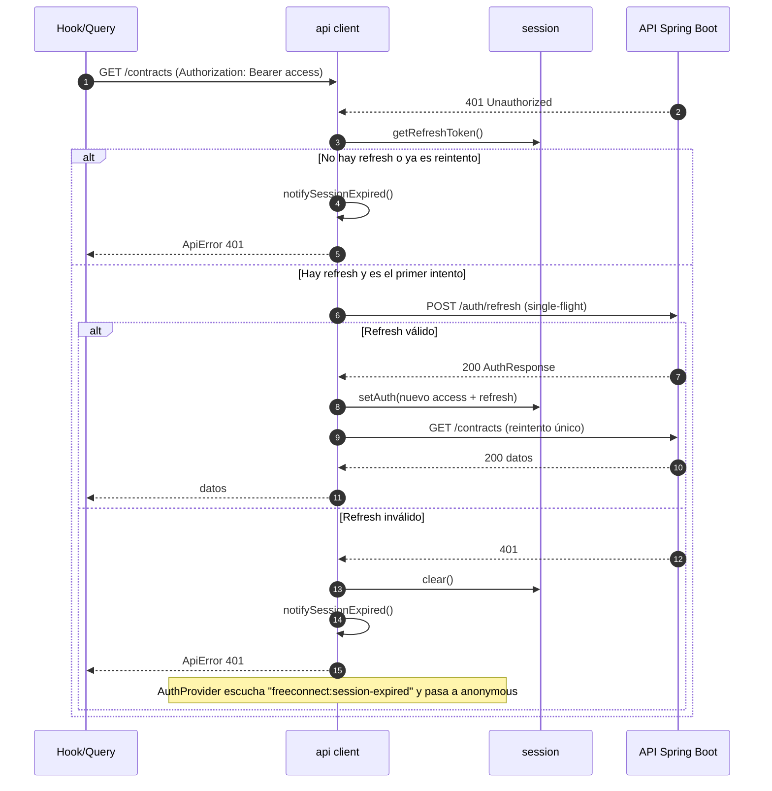
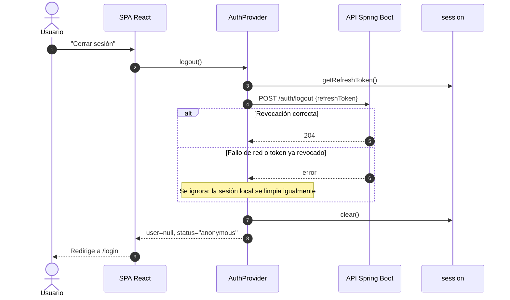
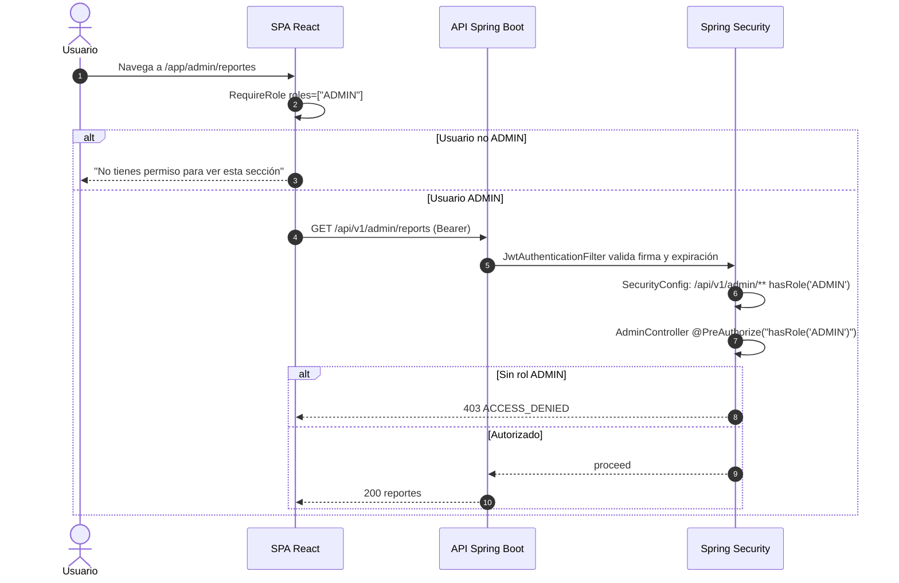

# Secuencia de autenticación

Registro, login, restauración de sesión, refresh single-flight y logout. El access
token vive solo en memoria; el refresh token se persiste en `sessionStorage` (riesgo
XSS documentado) y rota en cada uso.

## Registro

## Login y bootstrap

## Refresh automático ante 401

## Logout

## Rol y autorización

## Propiedades de seguridad

| Aspecto | Implementación |
|---------|----------------|
| Access token | Variable de módulo en `shared/api/session.ts`; no se escribe en `localStorage`. |
| Refresh token | `sessionStorage`; se envía solo a `/auth/refresh` y `/auth/logout`. |
| Rotación | Cada refresh devuelve un refresh nuevo; el anterior queda revocado. |
| Reintento 401 | Una sola vez por petición, con promesa single-flight compartida. |
| Logout | Revoca en backend y limpia estado local aunque falle la red. |
| Autorización real | Backend (`SecurityConfig` + `@PreAuthorize`); el frontend solo evita mostrar UI. |
| Riesgo XSS | Documentado en `frontend/README.md`; se recomienda cookie `HttpOnly` en producción. |
