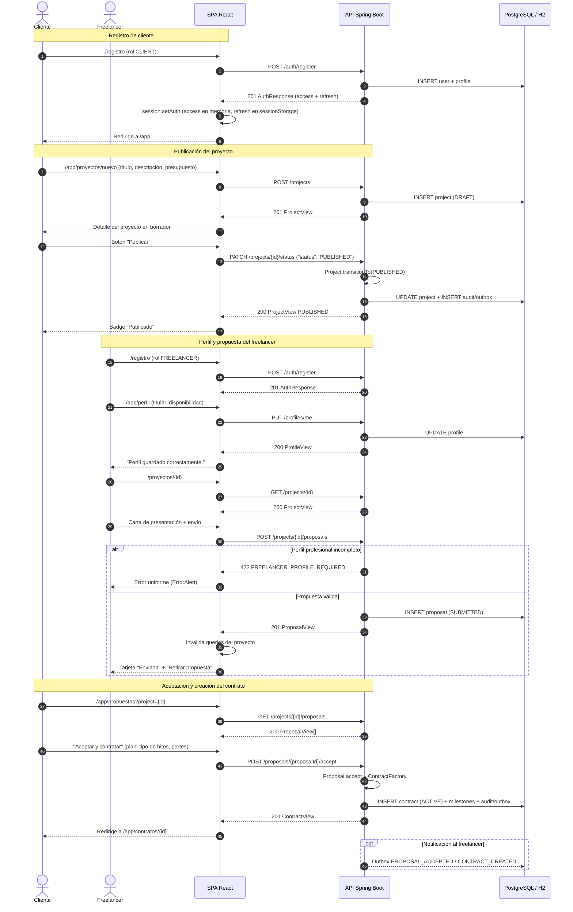
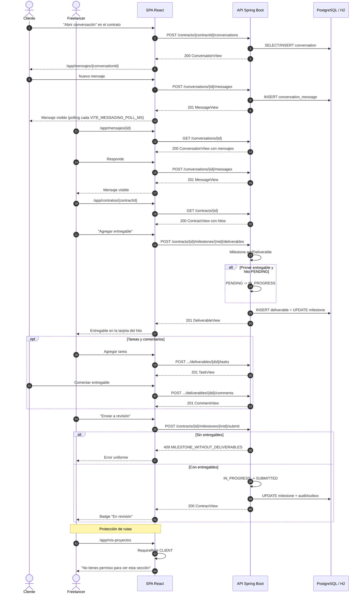
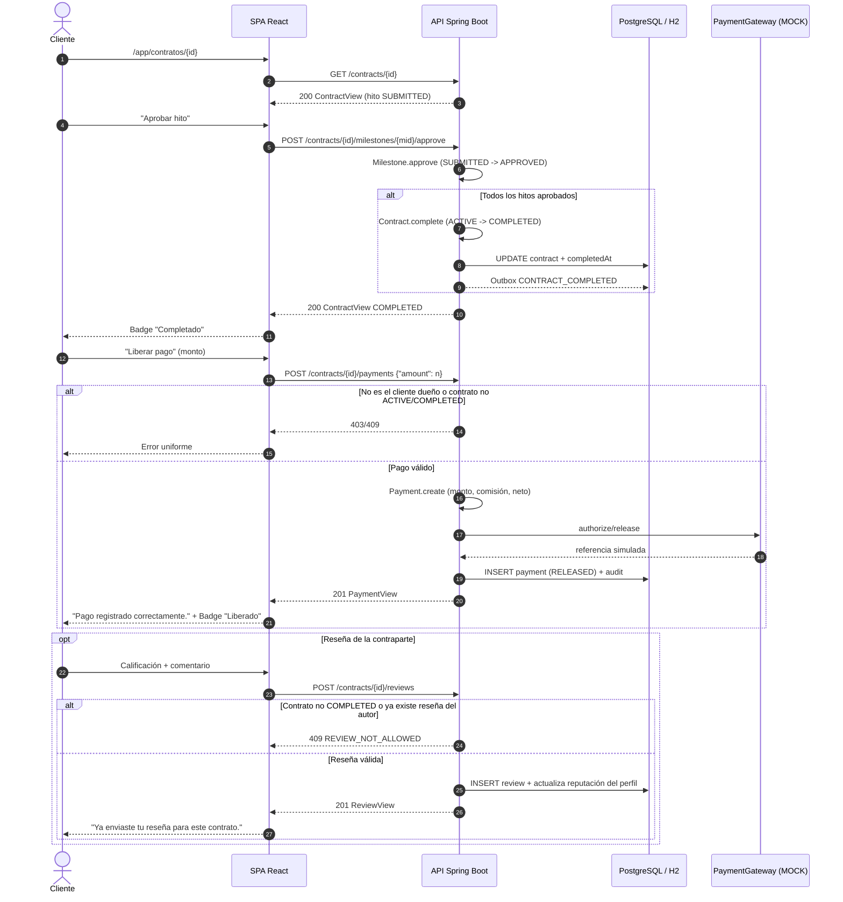

# Secuencia del flujo principal

Ciclo de negocio completo (RF-01 a RF-06). Se divide en tres tramos para que cada
diagrama sea legible; los IDs de mensaje continúan entre tramos.

## Tramo A — Registro, proyecto, propuesta y contrato

## Tramo B — Mensajería, entregables y revisión

## Tramo C — Aprobación, pago y reseña

## Notas de implementación

- El cliente HTTP reintenta **una sola vez** tras un `401` mediante `refreshAccessToken` (single-flight).
- No hay WebSockets: mensajes y notificaciones se actualizan por polling configurable.
- Los eventos de dominio alimentan notificaciones (outbox) y auditoría sin bloquear la respuesta.
- `%% TODO: confirmar` la política exacta de reintentos del `PaymentGateway`; en el MVP es un mock síncrono.
